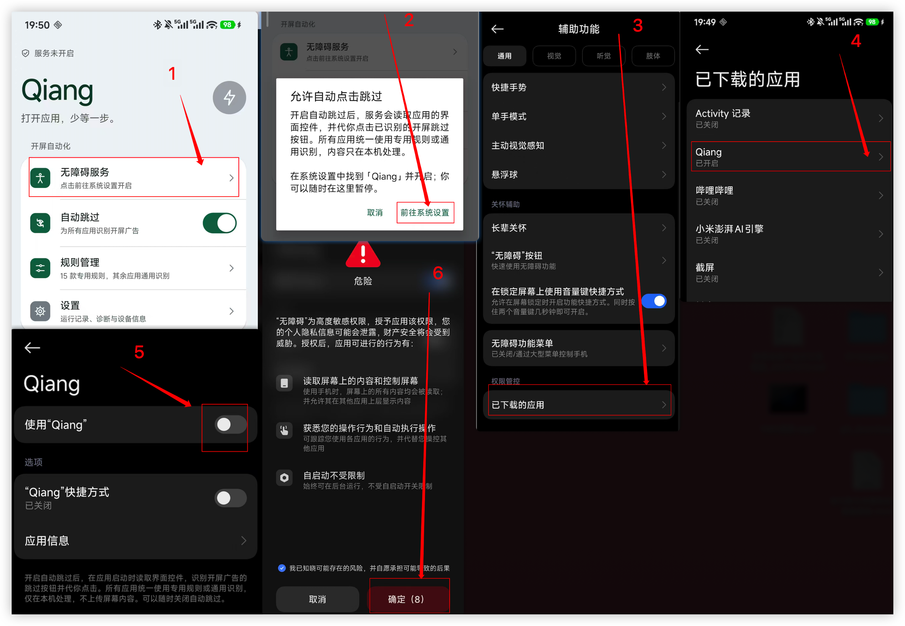
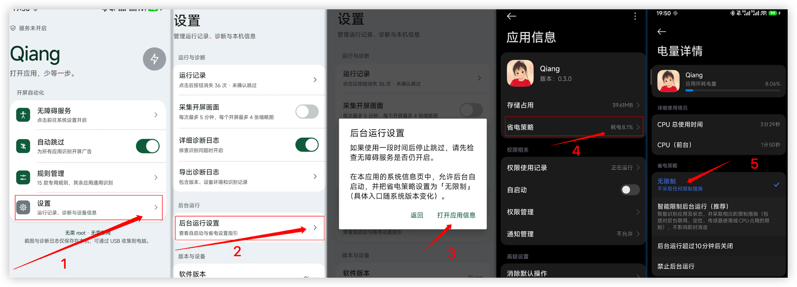

# Qiang 0.3.9

## 打包

源码构建需要 Python 3、JDK 17、Android SDK Platform 36.1 和 Build Tools 36.0.0。
可通过 `ANDROID_SDK_ROOT`（或 `ANDROID_HOME`）和 `ADSKIP_JAVA_HOME` 指定安装路径。

```bash
bash scripts/build.sh
```

APK 生成于 `artifacts/adskip-0.3.9-release.apk`。首次构建会下载 OCR 依赖，脚本会自动检查 APK。
请私下备份 `artifacts/release.jks` 和 `artifacts/release-signing.json`，以便后续更新应用；这两个文件不会提交到 Git。

# 使用教程

使用必看：  打开开发者选项。再往下操作

## 1、如何启用

1、打开无障碍设置

无障碍服务–>前往系统设置 –>已下载应用 –>选择对应软件 –> 打开使用–>点击确认（无障碍属于高风险操作。会提示。等待几秒之后才能点确认） –>返回首页显示已连接就可以了。右上角闪电图标变绿就是服务开启了




2、打开后台设置

打开软件设置 –>后台运行设置 –>打开应用信息 –>省电策略 –>选择无限制



3、点击首页自动跳过按钮。后面可以开始使用了。


## 2、使用

本项目是基于ocr图像识别。按钮坐标热点分析来判断，以及规则的导入等多种方式

1、屏幕框选（推荐）

首页–>规则管理–>点击矩形坐标规则/屏幕框选  –> 点击新增矩形规则·选择应用–>选择对应的应用。–>此时打开进入对应app–>允许进入–>出现广告点击框选范围–>点击保存

同一应用最多保存 10 个框选区域。进入该应用的区域列表，点击「新增框选区域」可继续添加；点击已有区域可编辑、暂停或删除。无论启用一条还是多条，框选都只作为 OCR 识别范围，不直接点击坐标。框选 OCR、普通 OCR、控件和模板同级并行，任一路识别到有效的跳过按钮就触发点击，不等待其他识别结束。同一按钮的重复结果会合并，按钮仍在时会依据新画面继续识别。框选时请完整包含按钮文字并保留少量边距。

[观看操作演示](docs/picture/27d1365a6043ae18277f3a3e89bb1adf.mp4)


目前主要在 Redmi K70 至尊版上测试，其他机型的效果尚未充分验证。
本项目仅供个人非商业学习、研究、测试和体验；禁止商用或未经许可向他人再分发，详见 [LICENSE](LICENSE)。
